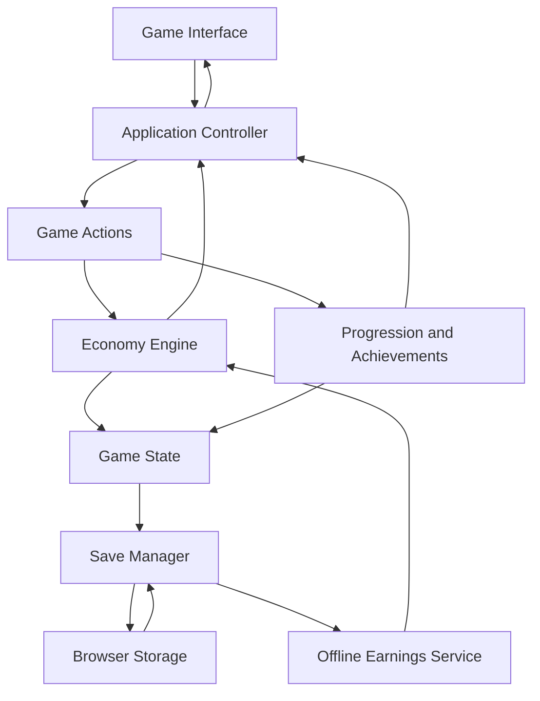

# Empire Architect: Technical Architecture

## 1. Architecture goals

Keep the simulation deterministic, testable, independent from the UI, and easy to extend. The first release uses vanilla HTML, CSS, and JavaScript ES modules with local browser storage.

## 2. Recommended stack

- HTML5, CSS3, vanilla JavaScript ES modules.
- LocalStorage for compact versioned saves; IndexedDB if state grows.
- Original CSS/SVG icon system or properly licensed assets.
- Git/GitHub for version control.
- Vercel or GitHub Pages for static hosting.
- A lightweight test runner appropriate for the repository.

No backend is required for version 1.0.

## 3. Architecture flow



## 4. File structure

```text
empire-architect/
├── index.html
├── README.md
├── LICENSE
├── .gitignore
├── assets/
│   ├── icons/
│   ├── illustrations/
│   └── fonts/
├── css/
│   ├── tokens.css
│   ├── reset.css
│   ├── layout.css
│   ├── components.css
│   ├── dashboard.css
│   └── responsive.css
├── js/
│   ├── main.js
│   ├── app/
│   │   ├── controller.js
│   │   ├── actions.js
│   │   ├── selectors.js
│   │   └── event-bus.js
│   ├── engine/
│   │   ├── economy.js
│   │   ├── simulation.js
│   │   ├── purchases.js
│   │   ├── upgrades.js
│   │   └── numbers.js
│   ├── data/
│   │   ├── businesses.js
│   │   ├── upgrades.js
│   │   ├── achievements.js
│   │   └── balance.js
│   ├── progression/
│   │   ├── levels.js
│   │   ├── unlocks.js
│   │   └── achievement-service.js
│   ├── persistence/
│   │   ├── save-manager.js
│   │   ├── migrations.js
│   │   └── offline-income.js
│   ├── ui/
│   │   ├── dashboard.js
│   │   ├── business-cards.js
│   │   ├── upgrade-panel.js
│   │   ├── achievement-panel.js
│   │   ├── navigation.js
│   │   ├── notifications.js
│   │   └── settings.js
│   └── utils/
│       ├── formatting.js
│       ├── validation.js
│       └── time.js
├── tests/
│   ├── economy.test.js
│   ├── purchases.test.js
│   ├── upgrades.test.js
│   ├── offline-income.test.js
│   ├── achievements.test.js
│   ├── persistence.test.js
│   └── integration.test.js
└── docs/
    ├── PRD.md
    ├── ARCHITECTURE.md
    ├── ECONOMY.md
    ├── DESIGN.md
    ├── TESTING.md
    └── ROADMAP.md
```

This is a target structure. Start smaller if useful, but preserve boundaries between simulation, persistence, and UI.

## 5. Service responsibilities

### Economy engine
Calculates costs, income, portfolio totals, multipliers, and payback estimates. Must not manipulate DOM or write to storage.

### Purchase service
Checks unlocks, quantity, affordability, and valid finite costs. Applies purchase transactions atomically.

### Upgrade service
Validates requirements and limits, computes costs/effects, deducts cash, and updates ownership.

### Simulation service
Advances the game based on elapsed time, not rendered frame count. Must be deterministic for a given state and elapsed duration.

### Save manager
Serializes state, versions the payload, safely writes/loads, validates data, and reports errors.

### Offline earnings service
Clamps eligible elapsed time, calculates offline income, grants it once, updates the processed timestamp, and saves.

### Achievement service
Evaluates centralized conditions, marks completion once, and applies configured rewards once.

### UI controller
Connects actions to services and renders state. It must not duplicate financial rules.

## 6. Data models

### Business definition
```js
{
  id: "parcel-relay",
  name: "Parcel Relay",
  category: "logistics",
  baseCost: 250,
  costGrowthRate: 1.15,
  baseNetIncomePerSecond: 2,
  unlock: { minimumLevel: 1 },
  icon: "parcel"
}
```

### Upgrade definition
```js
{
  id: "route-optimization",
  businessId: "parcel-relay",
  name: "Route Optimization",
  baseCost: 150,
  costGrowthRate: 1.6,
  effectPerLevel: 0.10,
  maxLevel: 25
}
```

### Player-owned business
```js
{
  businessId: "parcel-relay",
  quantity: 1,
  upgrades: { "route-optimization": 0 }
}
```

### Game state
```js
{
  schemaVersion: 1,
  balanceVersion: 1,
  createdAt: 0,
  lastSavedAt: 0,
  lastOfflineProcessedAt: 0,
  cash: 1000,
  lifetimeEarnings: 0,
  empireLevel: 1,
  experience: 0,
  businesses: [],
  unlockedBusinessIds: ["parcel-relay"],
  completedAchievementIds: [],
  statistics: {
    totalPurchases: 0,
    totalUpgrades: 0,
    totalPlaySeconds: 0
  },
  settings: {
    compactNumbers: true,
    reducedMotion: false,
    soundEnabled: false
  }
}
```

### Save envelope
```js
{
  appId: "empire-architect",
  schemaVersion: 1,
  savedAt: 0,
  state: {},
  checksum: null
}
```

Timestamps are placeholders and must be initialized at runtime.

## 7. Persistence design

- Use a stable storage key, e.g. `empire-architect-save`.
- Save after meaningful transactions and periodically with throttling.
- Validate the application identifier, schema, values, IDs, timestamps, quantities, and levels.
- Recompute derived income from authoritative ownership/upgrades.
- Migrate supported older schema versions explicitly.
- Keep a recent valid backup when practical.
- Do not report a successful save until storage succeeds.
- Provide safe recovery for malformed or unsupported saves.
- Reset must require confirmation.

## 8. Offline progression sequence

1. Load and validate saved state.
2. Read the previous processed timestamp.
3. Calculate elapsed wall-clock time.
4. Clamp to the configured offline cap.
5. Compute earnings using the saved portfolio income.
6. Apply the reward once.
7. Update the processed timestamp.
8. Save the updated state.
9. Display the offline summary.

Version 1.0 has no evolving market state while offline. Local clock manipulation cannot be made fully cheat-proof without a trusted server.

## 9. Engineering rules

1. Business definitions and player ownership are separate.
2. All cash transactions are centralized.
3. Financial calculations use one authoritative engine.
4. Save migrations are separate from simulation logic.
5. Achievement definitions are separate from their UI.
6. Rendering frequency never determines income.
7. Avoid circular dependencies between services.
8. Version save schema and balance configuration separately.
9. Keep balance constants configurable.
10. Test simulation services without a browser UI.

## 10. Future extensibility

Future stocks, employees, real estate, rivals, and cloud saves should be separate modules or services. They must not become dependencies of the version-one economy engine. Multiplayer or competitive features require server-side validation.
